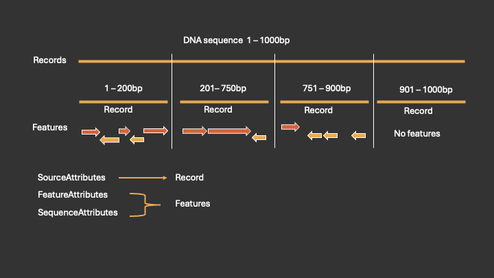
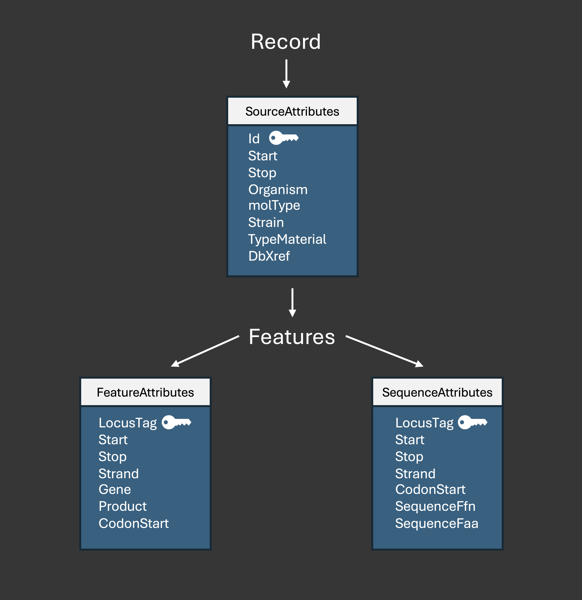

**File types and Parsing behaviour**

**Genbank (.gbk) & Embl (.embl)**
GenBank and EMBL are structured plain-text formats for annotated nucleotide sequences. While syntax differs, microBioRust parses both and supports converting either format to GFF3.

*Structure and Parsing*

Top Level is the Records type. Each genome file has only one top level Records type.
Macros have getters and setters for the data, these are SourceAttributes, FeatureAttributes, NonCodingAttributes and SequenceAttributes.

At the next level is the Record type. There may be one or many Record in a Records (up to ~ 2000 but more usually ~ 50 in a Bacterial genome). Each Record holds the DNA sequence which is calculated on the fly by slicing the total sequence of Records with the start and stop coordinates. 
Each Record also holds the contig's id, nucleotide sequence, coordinates, and four typed attribute builders backed by macro-generated getters (get_<field>) and setters (set_<field>)

1. source_map (SourceAttributeBuilder $\rightarrow$ SourceAttributes): Record-level metadata (organism, mol_type, strain, db_xref, etc.) and the total start and stop coordinates of the contig sequence
2. cds (FeatureAttributeBuilder $\rightarrow$ 2. FeatureAttributes): Per-CDS annotation metadata (gene, product, start, stop, strand, codon_start, transl_table), keys are the locus_tag
3. nc_features (NonCodingAttributeBuilder $\rightarrow$ NonCodingAttributes): Non-coding genomic features (rRNA, tRNA, tmRNA, ncRNA, misc_RNA, regulatory, repeat_region, mobile_element, misc_feature), keys are feature_id
4. seq_features (SequenceAttributeBuilder $\rightarrow$ SequenceAttributes): Per-CDS nucleotide (.ffn) and translated protein (.faa) sequences, keys are the locus_tag.

{ loading=lazy }

The full structure of the SourceAttributes, FeatureAttributes and SequenceAttributes is:

{ width=500 }

#Attribute Structs & Supporting Types

**RangeValue**
Sequence coordinates use RangeValue to capture exact positions as well as partial/truncated boundaries (common at the start and end of contigs):
RangeValue can be either < value, > value or most commonly Exact value
Most RangeValues are Exact(value) with exceptions usually at the start and end of sequences, indicating that they are truncated.
```
pub enum RangeValue {
    Exact(u32),
    LessThan(u32),    // e.g., <1 (5' partial)
    GreaterThan(u32), // e.g., >500 (3' partial)
}
```
**SourceAttributes** stores record-level metadata from top level record source_map (accessed via record.source_map.get_organism(key), record.source_map.get_start(key), etc.). 
Note that start and stop here refer to the entire record/contig sequence, rather than individual coding sequences:

```
pub struct SourceAttributes {
    pub start: Option<RangeValue>,
    pub stop: Option<RangeValue>,
    pub organism: Option<String>,
    pub mol_type: Option<String>,
    pub strain: Option<String>,
    pub culture_collection: Option<String>,
    pub type_material: Option<String>,
    pub db_xref: Option<String>,
}
```
**FeatureAttributes**

Each Record can have None or many hundreds of coding sequences, CDS (stored in the FeatureAttributes).
These are the predicted genes and contain annotation data per gene such as locus_tag (id), gene (may be empty), start, stop, strand (-1 or +1), codon start (1,2 or 3), product.

FeatureAttributes stores the following in an enum:

```
pub struct FeatureAttributes {
    pub feature_type: Option<FeatureKind>,
    pub start: Option<RangeValue>,
    pub stop: Option<RangeValue>,
    pub gene: Option<String>,
    pub product: Option<String>,
    pub codon_start: Option<u8>,
    pub transl_table: Option<TranslTable>,
    pub strand: Option<i8>,
    // ec_number: Option<String>, // available to enable if needed
}
```
Gene may be None (if no name has been associated with the cds), strand is either -1 (reverse) or +1 (forward).
The codon_start is 1, 2, or 3 (reading frame offset).  The transl_table wraps a validated NCBI translation table ID (1..=33).
currently EC_number is commented out but could be added back if there is demand

Each CDS also has a DNA sequence .ffn (calculated on the fly from the start, stop and strand) and a protein sequence .faa (translated on the fly from the start, stop, strand and codon_start). The sequences are stored in the SequenceAttributes.

SequenceAttributes stores the following:
For each CDS, the coding nucleotide sequence (.ffn) is sliced from the contig sequence using start, stop, and strand, and the protein sequence (.faa) is translated on the fly using codon_start and transl_table. These are stored in record.seq_features

```
pub struct SequenceAttributes {
    pub start: Option<RangeValue>,
    pub stop: Option<RangeValue>,
    pub sequence_ffn: Option<String>,
    pub sequence_faa: Option<String>,
    pub codon_start: Option<u8>,
    pub strand: Option<i8>,
}
```

Note the start, stop, strand and codon start of SequenceAttributes and FeatureAttributes are identical
Although start, stop, strand, and codon_start match across both structs, storing sequences separately in SequenceAttributes keeps memory layout efficient while allowing sequence slicing/translation and feature metadata queries to run independently without cross-table lookups.  Keeping them together may make it easier to slice the sequence and access the specific feature metadata at the same time.

**Rust Usage Examples**

Parsing GenBank & EMBL with Macros (genbank! / embl!)
The genbank! and embl! convenience macros parse a file into a Vec<Record>. You can inspect features using either the generated get_* methods or by iterating over the underlying BTreeMap (attributes / seq_attributes / source_attributes):

```
use microBioRust::{embl, genbank};

fn main() {
    // Parse a GenBank file (or use embl!("example.embl") for EMBL)
    let records = genbank!("tests/K12_ribo.gbk");

    for record in &records {
        println!("Contig: {} ({} bp)", record.id, record.sequence.len());

        // Inspect source metadata
        if let Some((source_key, src)) = record.source_map.source_attributes.first_key_value() {
            println!("Source: {} | Organism: {:?}", source_key, src.organism);
        }

        // Iterate over all CDS locus tags in sorted order
        for (locus_tag, feat) in &record.cds.attributes {
            // Access fields directly on the FeatureAttributes struct
            // or via generated getters (e.g., record.cds.get_gene(locus_tag))
            println!(
                "{}: gene={:?}, product={:?}, {:?}..{:?} (strand {:?})",
                locus_tag, feat.gene, feat.product, feat.start, feat.stop, feat.strand
            );

            // Retrieve translated protein (.faa) and nucleotide (.ffn) sequences
            if let Some(faa) = record.seq_features.get_sequence_faa(locus_tag) {
                println!(">{}\n{}", locus_tag, faa);
            }
            if let Some(ffn) = record.seq_features.get_sequence_ffn(locus_tag) {
                println!(">{}_cds\n{}", locus_tag, ffn);
            }
        }
    }
}
```
Streaming Records from Any BufRead Source
For streaming large files or parsing in-memory buffers (Cursor), use gbk::Reader (or embl::Reader) with RecordRead:

```
use microBioRust::gbk::Reader;
use microBioRust::record::{Record, RecordRead};
use std::fs::File;
use std::io::BufReader;

fn stream_gbk(path: &str) -> anyhow::Result<()> {
    let file = File::open(path)?;
    let mut reader = Reader {
        reader: BufReader::new(file),
        line_buffer: String::new(),
    };

    loop {
        let mut record = Record::default();
        reader.read(&mut record)?;
        if record.is_empty() {
            break;
        }
        println!("Loaded {} ({} CDS entries)", record.id, record.cds.attributes.len());
    }

    Ok(())
}
```
Note on joined CDS features: Multi-exon or spliced features such as join(1..3,10..12) are stored as indexed segment keys (<locus_tag>_0, <locus_tag>_1, etc.) in both record.cds.attributes and record.seq_features.seq_attributes.

**Converting GenBank / EMBL to GFF3**


```
use microBioRust::genbank;
use microBioRust::gbk::gff_write;
use std::collections::BTreeMap;

fn convert_gbk_to_gff(input_path: &str, output_path: &str, include_dna: bool) -> anyhow::Result<()> {
    let records = genbank!(input_path);
    let mut seq_region: BTreeMap<String, (u32, u32)> = BTreeMap::new();
    let mut record_vec = Vec::new();
    let mut offset: u32 = 0;

    for record in records {
        if let Some(ref source) = record.source_map.source_name {
            let start = record.source_map.get_start(source).map_or(0, |v| v.get_value());
            let stop = record.source_map.get_stop(source).map_or(0, |v| v.get_value());

            seq_region.insert(source.to_string(), (start + offset, stop + offset));
            record_vec.push(record);
            offset += stop;
        }
    }

    gff_write(seq_region, record_vec, output_path, include_dna)?;
    Ok(())
}
```
